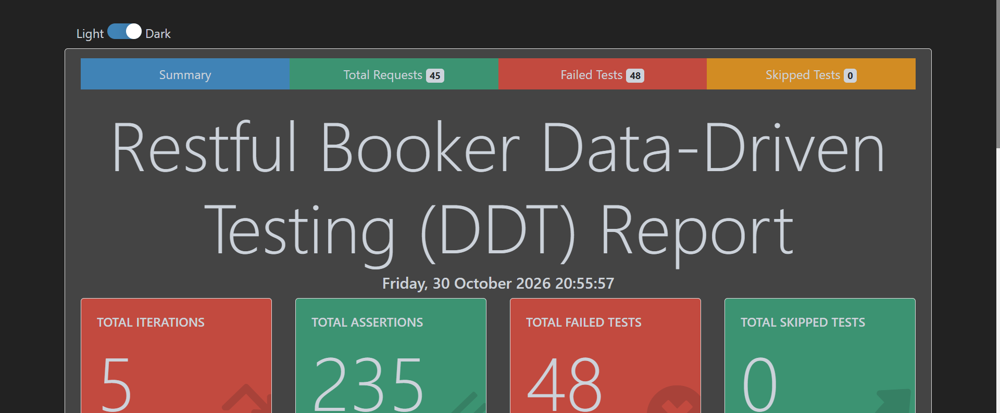

# 📊 Restful Booker API — Data-Driven Testing (DDT) Framework

[](https://github.com/TanzimSQA/restful-booker-data-driven-testing/actions)
[](./Restful%20Booker%20API.postman_collection.json)
[](https://www.npmjs.com/package/newman)
[](https://www.npmjs.com/package/newman-reporter-htmlextra)
[](https://nodejs.org/)
[](./LICENSE)

A production-grade **Data-Driven Testing (DDT)** automation framework for **[Restful Booker](https://restful-booker.herokuapp.com/apidoc/index.html)**. Parameterized using external CSV datasets, executed headlessly via **Newman CLI**, with automated JSON normalization, robust defensive Base URL handling, and interactive **HTML Extra** test reporting backed by **GitHub Actions CI/CD**.

---

## 📑 Table of Contents
- [📌 Project Overview](#-project-overview)
- [📁 Repository Architecture](#-repository-architecture)
- [📋 CSV Dataset Schema](#-csv-dataset-schema)
- [⚡ Data-Driven Testing Mechanics](#-data-driven-testing-mechanics)
- [🛡️ Base URL & Boolean Auto-Sanitization](#️-base-url--boolean-auto-sanitization)
- [🎯 API Endpoints Covered](#-api-endpoints-covered)
- [🚀 Quick Start & Local Execution](#-quick-start--local-execution)
- [📊 HTML Extra Test Report](#-html-extra-test-report)
- [🔄 CI/CD Automation (GitHub Actions)](#-cicd-automation-github-actions)
- [👨‍💻 Author](#-author)

---

## 📌 Project Overview
In API automation, **Data-Driven Testing (DDT)** decouples test logic from test data. Instead of hardcoding customer details, this framework feeds **1,052 distinct test records** from a parameterized CSV file (`Datasheet-for-DDT - Sheet1.csv`) into the Postman test engine.

### Key Highlights
- **1,052 Multi-National Test Records**: Simulates real-world international guest bookings with diverse names, currencies, pricing tiers, and special requests.
- **Dynamic Iteration Chaining**: In each iteration, dynamic tokens and newly generated booking IDs are extracted and propagated into GET, PUT, PATCH, and DELETE operations.
- **Robust Schema Normalization**: Automatically converts uppercase Excel booleans (`TRUE`/`FALSE`) into valid JSON tokens (`true`/`false`), preventing API syntax errors.
- **Automated Base URL Self-Healing**: Resilient pre-request script guarantees URL resolution regardless of environment file state or trailing slashes.
- **Interactive Multi-Iteration HTML Reports**: Generates comprehensive visual dashboards detailing every iteration, request, response, and assertion.

---

## 📁 Repository Architecture

```text
restful-booker-data-driven-testing/
├── .github/
│   └── workflows/
│       └── ddt-tests.yml                      # GitHub Actions CI workflow
├── reports/
│   └── Restful_Booker_DDT_Newman_Report.html  # Newman HTML Extra multi-iteration report
├── screenshots/
│   ├── ddt_report_summary.png                 # Dashboard KPI & summary capture
│   └── ddt_report_full.png                    # Full-page execution breakdown
├── Datasheet-for-DDT - Sheet1.csv              # Primary DDT dataset (1,052 rows)
├── Restful Booker API.postman_collection.json  # DDT-optimized Postman Collection v2.1.0
├── Restful_Booker_API.postman_collection.json  # CLI-friendly collection alias (no spaces)
├── RestfulBooker_Env.postman_environment.json   # Postman Environment Variables
├── package.json                               # NPM scripts and runner dependencies
├── .gitignore                                 # Git exclusions
├── LICENSE                                    # MIT License
└── README.md                                  # Project documentation
```

---

## 📋 CSV Dataset Schema
The test suite consumes [`Datasheet-for-DDT - Sheet1.csv`](./Datasheet-for-DDT%20-%20Sheet1.csv), structured across 7 key attributes:

| Column Header | Data Type | Sample Value | Description |
| :--- | :--- | :--- | :--- |
| `firstname` | String | `Abdur` | Guest first name |
| `lastname` | String | `Rahman` | Guest surname |
| `totalprice` | Number | `508` | Booking reservation total cost |
| `depositpaid` | Boolean (Excel) | `TRUE` / `FALSE` | Deposit confirmation status |
| `checkin` | Date (`YYYY-MM-DD`) | `2026-10-16` | Hotel check-in date |
| `checkout` | Date (`YYYY-MM-DD`) | `2026-10-16` | Hotel check-out date |
| `additionalneeds` | String | `coffee` / `Airport shuttle` | Special customer requests |

---

## ⚡ Data-Driven Testing Mechanics

### Variable Precedence Handling
In Postman and Newman, **Iteration Data** (`pm.iterationData`) holds the highest variable precedence. During execution, each CSV row automatically maps to matching double-curly variable references (e.g., `{{firstname}}`, `{{totalprice}}`).

### Dynamic CSV Injection in Pre-Request Scripts
```javascript
// Automatically detect and prioritize CSV iteration data
if (pm.iterationData && (pm.iterationData.get("firstname") || pm.iterationData.get("firstName"))) {
    const fn = pm.iterationData.get("firstname") || pm.iterationData.get("firstName");
    const ln = pm.iterationData.get("lastname") || pm.iterationData.get("lastName");
    const tp = Number(pm.iterationData.get("totalprice")) || 0;
    const dpRaw = pm.iterationData.get("depositpaid");
    const dp = (String(dpRaw).toLowerCase() === 'true' || dpRaw === true);
    const cin = pm.iterationData.get("checkin");
    const cout = pm.iterationData.get("checkout");
    const needs = pm.iterationData.get("additionalneeds");

    // Construct syntactically validated JSON body
    const bodyObj = {
        firstname: fn,
        lastname: ln,
        totalprice: tp,
        depositpaid: dp,
        bookingdates: { checkin: cin, checkout: cout },
        additionalneeds: needs
    };
    pm.request.body.raw = JSON.stringify(bodyObj);

    // Sync to environment for assertion verification
    pm.environment.set("firstname", fn);
    pm.environment.set("lastname", ln);
    pm.environment.set("totalprice", String(tp));
    pm.environment.set("depositpaid", String(dp));
}
```

---

## 🛡️ Base URL & Boolean Auto-Sanitization
A collection-level pre-request handler eliminates two common causes of API test suite failure:

1. **Missing or Blank `baseUrl`**: Automatically detects empty strings and falls back to `https://restful-booker.herokuapp.com`.
2. **Double Slash (`//`) Prevention**: Strips trailing slashes from the host URL before request construction.
3. **Boolean Syntax Healing**: Excel exports booleans as `TRUE`/`FALSE`. Raw injection produces invalid JSON (`{"depositpaid": TRUE}`). The pre-request script normalizes these to lowercase `true`/`false`.

---

## 🎯 API Endpoints Covered

| # | Endpoint Name | Method | Path | DDT Parameterization | Expected Status |
|---|---------------|:------:|------|:--------------------:|:---------------:|
| 1 | **CreateToken** | `POST` | `/auth` | Admin Credentials | `200 OK` |
| 2 | **GetBookingIds** | `GET` | `/booking/` | Dynamic ID Query | `200 OK` |
| 3 | **CreateBooking** | `POST` | `/booking` | **100% Parameterized via CSV** | `200 OK` |
| 4 | **GetBooking** | `GET` | `/booking` | Schema & List Verification | `200 OK` |
| 5 | **UpdateBooking** | `PUT` | `/booking/{id}` | Parameterized Payload + Token | `200 OK` |
| 6 | **PartialUpdateBooking** | `PATCH` | `/booking/{id}` | Partial Patch + Token | `200 OK` |
| 7 | **DeleteBooking** | `DELETE` | `/booking/{id}` | Dynamic Booking Cleanup | `201 Created` |
| 8 | **GetBooking Copy** | `GET` | `/booking` | Latency & Size SLA | `200 OK` |
| 9 | **HealthCheck** | `GET` | `/ping` | Server Health Ping | `201 Created` |

---

## 🚀 Quick Start & Local Execution

### Prerequisites
- [Node.js](https://nodejs.org/) (v18.x or higher)
- [Postman](https://www.postman.com/) (Optional)

### 1. Clone the Repository
```bash
git clone https://github.com/TanzimSQA/restful-booker-data-driven-testing.git
cd restful-booker-data-driven-testing
```

### 2. Install Newman & Reporter
```bash
npm install
```

### 3. Run Multi-Iteration DDT Suite

**Run 5 iterations with Console Summary:**
```bash
npm test
```

**Run 5 iterations and generate HTML Extra Report:**
```bash
npm run test:report
```

**Run All 1,052 Iterations:**
```bash
npm run test:full
```

Or execute directly with Newman CLI:
```bash
newman run "Restful Booker API.postman_collection.json" \
  -e "RestfulBooker_Env.postman_environment.json" \
  -d "Datasheet-for-DDT - Sheet1.csv" \
  -n 5 \
  --delay-request 300 \
  -r cli,htmlextra \
  --reporter-htmlextra-export ./reports/Restful_Booker_DDT_Newman_Report.html \
  --reporter-htmlextra-title "Restful Booker Data-Driven Testing (DDT) Report"
```

---

## 📊 HTML Extra Test Report
The test suite utilizes `newman-reporter-htmlextra` to generate a multi-iteration dashboard with:
- **Global KPI Summary**: Executed iterations, total requests, assertions, average latency, and payload transferred.
- **Per-Iteration Breakdown**: View payloads and assertions individually for Iteration 1 through 5.
- **Request & Response Body Viewer**: Inspect exact payloads sent from each CSV row.

### 📸 Execution Dashboard Preview
<p align="center">
  
</p>

The HTML report is saved and archived at:
```text
reports/Restful_Booker_DDT_Newman_Report.html
```

---

## 🔄 CI/CD Automation (GitHub Actions)
The included workflow `.github/workflows/ddt-tests.yml` executes on every push and pull request to `main`:
1. Checks out the code and test data.
2. Configures Node.js, Newman, and `newman-reporter-htmlextra`.
3. Runs the parameterized DDT suite against the live API.
4. Archives and uploads the HTML Extra test report as a workflow artifact (`retention: 30 days`).

---

## 👨‍💻 Author
**Tanzim Rahman**  
*Software Quality Assurance Engineer*  
- **GitHub**: [@TanzimSQA](https://github.com/TanzimSQA)
- **LinkedIn**: [Tanzim Rahman](https://www.linkedin.com/in/tanzim-rahman-sqa)

---

## 📄 License
This project is licensed under the [MIT License](LICENSE).
